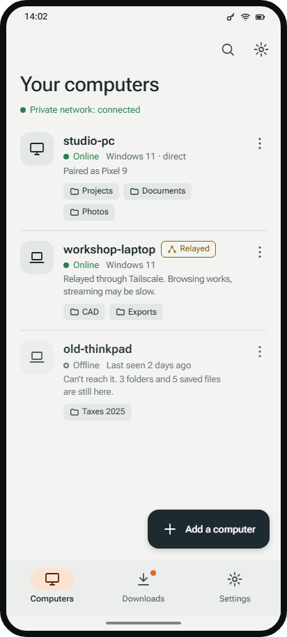
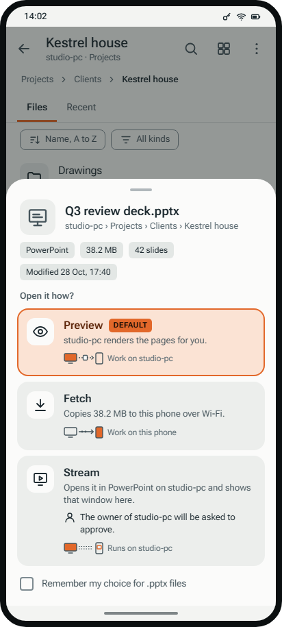
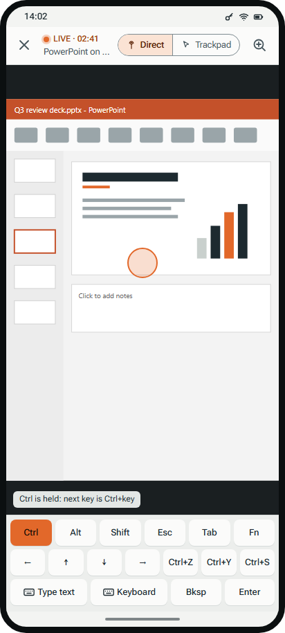
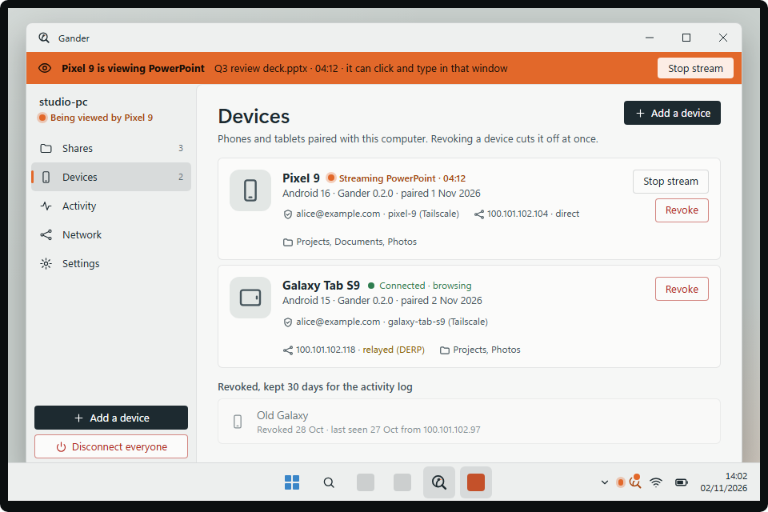

  <picture>
    <source media="(prefers-color-scheme: dark)" srcset="brand/gander-lockup-reversed.svg">
    
  </picture>

# Gander

**Have a gander at your files: on your phone, from your own computer, over your own private network.**

You already have your phone and your computer on a private network such as Tailscale. This app
uses that connection so you can browse the folders you choose to share and, for each file, decide
where it gets opened:

| Mode | What happens | Uses whose resources |
| --- | --- | --- |
| **Preview** | The computer makes a quick preview (thumbnail, page images, text) | Computer, a little |
| **Fetch** | The file is sent to your phone and opened with a phone app | Phone |
| **Stream** | The file opens in the real desktop app on your computer, and only that window is streamed to your phone | Computer |

Example: a `.pptx` can be fetched and opened in a phone office app, or streamed from PowerPoint
on the computer. A `.blend` file can't be opened on a phone at all, so you stream Blender.

## What it is not

- Not a cloud drive. No account, no servers of ours, nothing leaves your private network. (Your
  VPN may relay traffic through its own servers when a direct path is unavailable; see
  [A note on relays](#a-note-on-relays).)
- Not full remote desktop. You see one app window for one file, not your whole machine.
- Not a sync tool. Files stay where they are unless you choose to fetch them.

## Requirements

- A private network between your devices: Tailscale, Headscale, ZeroTier, or WireGuard.
- The host app on each computer you want to reach. The mobile app on your phone or tablet.

## A note on relays

Gander has no relay or cloud service of its own. It reaches your computer over the private
network you already run, and that network decides the path. When the phone and the computer
cannot connect directly (strict NAT, mobile data, a locked-down Wi-Fi), Tailscale may route the
traffic through its DERP relay servers instead. Other private networks have their own
equivalents. What that means for you:

- **Still end-to-end encrypted.** The relay carries WireGuard packets it cannot read, and Gander
  adds its own layer: TLS pinned to your computer's certificate, and for Stream, WebRTC's
  DTLS-SRTP. A relay can slow a connection down; it cannot read or change what is in it.
- **Slower.** A relayed path adds latency and often lowers throughput. Browsing and previews
  feel it a little, large fetches take longer, and Stream may be choppy or unusable.
- **Gander tells you.** The phone app marks a relayed computer, warns before a stream starts over
  a relayed path, and the host's Network window shows the path for each device.
- **Nothing else leaves.** No Gander server, no account, no telemetry by default.

## Status

Version 0.1.0, in development and not yet released as a signed build. Built and tested: the
Windows host (tray app, shares, pairing, Preview, Fetch, folder zips, deep-zoom previews, Windows
Search), the Android client for it (including the Files-app integration), and the Stream stack
(window capture, hardware H.264, WebRTC, sound from the streamed app, input, session lifecycle, the
phone viewer and the opt-in clipboard text bridge). A per-user MSI is built by
`cargo xtask installer-build`. See [`docs/context.md`](./docs/context.md) for the current state and
next steps, and [`docs/`](./docs) for the vision, research, architecture, security model, specs
and plan.

## Design

  
  
  

  

The design system and screen inventory: [`docs/design/2026-11-02-ui-redesign.md`](./docs/design/2026-11-02-ui-redesign.md).
Every screen in light and dark: [`docs/design/mockups/README.md`](./docs/design/mockups/README.md),
and the clickable version in [`docs/design/mockups/index.html`](./docs/design/mockups/index.html).
The logo and icons are in [`brand/`](./brand).

## License

Apache-2.0, see [`LICENSE`](./LICENSE). This is the working default; the owner confirms it
(`docs/decisions/0003-license.md`, still Proposed) before anything is published.
