<!-- Generated by `cargo xtask mockups` from the screen registry in index.html. Do not edit by hand. -->

# Gander UI mockups

The approved mockups of the Android phone and tablet client and the Windows host, as clickable HTML and as images of every screen: 48 screens, each in a light and a dark theme. The design and the reasons for it are in [the UI redesign](../2026-11-02-ui-redesign.md).

- **Clickable mockups.** Open [`index.html`](index.html) in a browser (one file, no build). Every screen has a route, `index.html#/<id>`, where `<id>` is the code shown under the screen name below. `?theme=light` or `?theme=dark` picks the theme, the left and right arrow keys step through the screens, and "Tap targets" outlines what can be tapped. Roboto Flex and Roboto Mono load from Google Fonts; offline, system fonts take over.
- **Images.** `png/<group>/<id>-light.png` and `png/<group>/<id>-dark.png`, the device frame only, at 1x, with transparent corners and no metadata.
- **Sample data.** Everything on screen is invented: the computers (`studio-pc`, `workshop-laptop`), the account (`alice@example.com`), the folders, the network names and the `100.101.102.x` addresses. Phone and tablet models (Pixel 9, Galaxy Tab S9) are only examples. No real people, machines, paths or tokens.
- **Regenerate.** `cargo xtask mockups` renders every screen again with headless Microsoft Edge (or another Chromium, `--browser <path>`) and rewrites the images and this index. Run it after changing `index.html`, and commit the result. `--only <id>` renders one screen.

## Design system

| Light | Screen |
| --- | --- |
| <a href="png/design-system/tokens-light.png">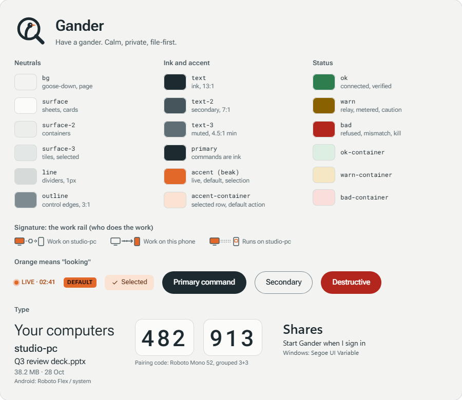</a> | **01. Tokens and signatures** `tokens`  The palette in the current theme, the work rail, how orange is used, and the type pairing. Switch the theme to compare.  [Light](png/design-system/tokens-light.png) · [Dark](png/design-system/tokens-dark.png) |

## Android phone

| Light | Screen |
| --- | --- |
| <a href="png/android-phone/hosts-empty-light.png">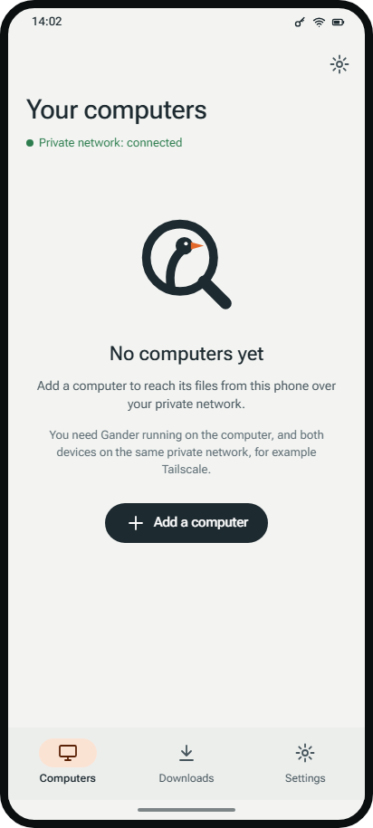</a> | **02. Computers: empty** `hosts-empty`  First run. One clear action, and a plain explanation of what is needed on the computer.  [Light](png/android-phone/hosts-empty-light.png) · [Dark](png/android-phone/hosts-empty-dark.png) |
| <a href="png/android-phone/hosts-light.png">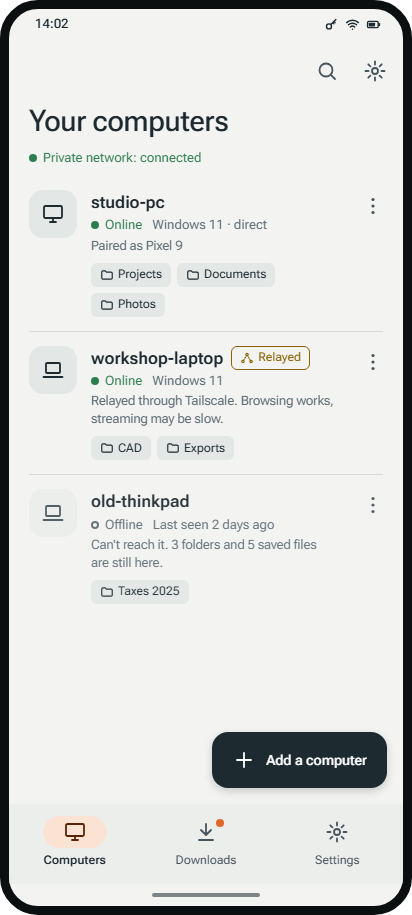</a> | **03. Computers** `hosts`  Home: your computers, with state, path and quick jumps into shares.  [Light](png/android-phone/hosts-light.png) · [Dark](png/android-phone/hosts-dark.png) |
| <a href="png/android-phone/add-light.png">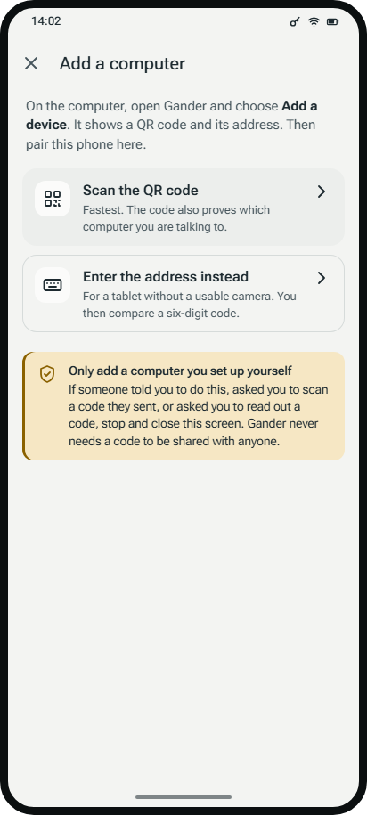</a> | **04. Add computer: start** `add`  Choose QR or manual, with the anti-scam warning before anything else.  [Light](png/android-phone/add-light.png) · [Dark](png/android-phone/add-dark.png) |
| <a href="png/android-phone/add-scan-light.png">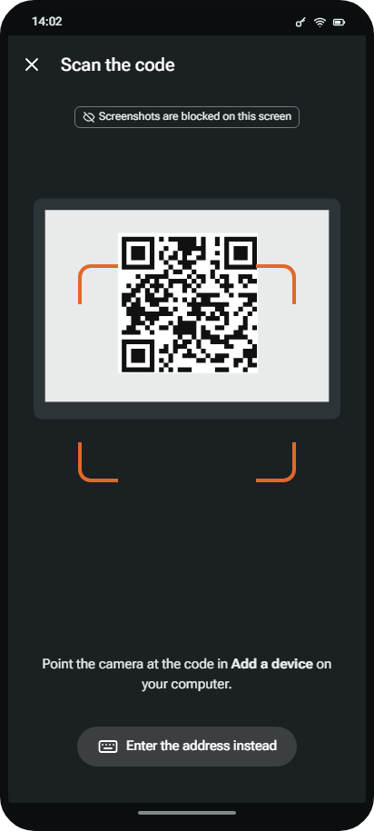</a> | **05. Add computer: scan** `add-scan`  Camera with an orange reticle. FLAG_SECURE is on, so screenshots are blocked and the screen says so.  [Light](png/android-phone/add-scan-light.png) · [Dark](png/android-phone/add-scan-dark.png) |
| <a href="png/android-phone/add-manual-light.png">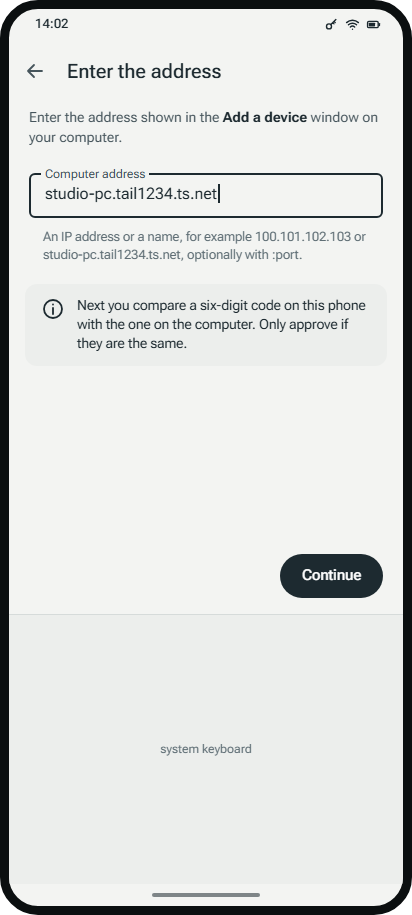</a> | **06. Add computer: address** `add-manual`  Manual address entry (flow B) and a preview of the code comparison that follows.  [Light](png/android-phone/add-manual-light.png) · [Dark](png/android-phone/add-manual-dark.png) |
| <a href="png/android-phone/add-compare-light.png">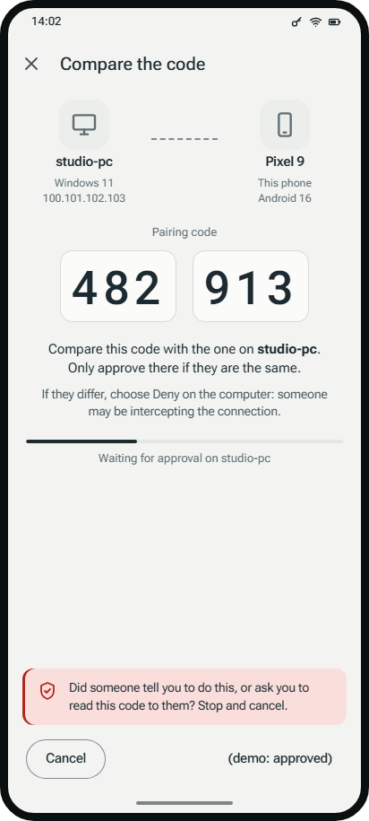</a> | **07. Add computer: compare code** `add-compare`  Flow B: the code is the integrity check, so it is the largest thing on the screen, with both device identities above it.  [Light](png/android-phone/add-compare-light.png) · [Dark](png/android-phone/add-compare-dark.png) |
| <a href="png/android-phone/add-waiting-light.png">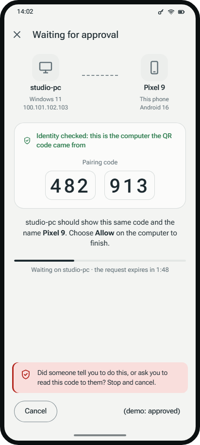</a> | **08. Add computer: waiting (QR)** `add-waiting`  Flow A: identity already proved by the QR; the code is informational, shown smaller with a green identity check.  [Light](png/android-phone/add-waiting-light.png) · [Dark](png/android-phone/add-waiting-dark.png) |
| <a href="png/android-phone/add-ok-light.png">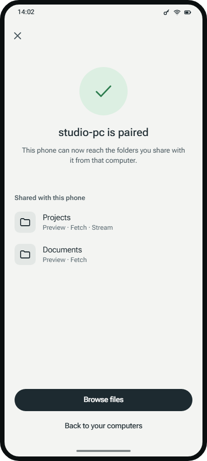</a> | **09. Add computer: success** `add-ok`  Confirms the pairing and shows what is shared with this phone right away.  [Light](png/android-phone/add-ok-light.png) · [Dark](png/android-phone/add-ok-dark.png) |
| <a href="png/android-phone/add-fail-light.png">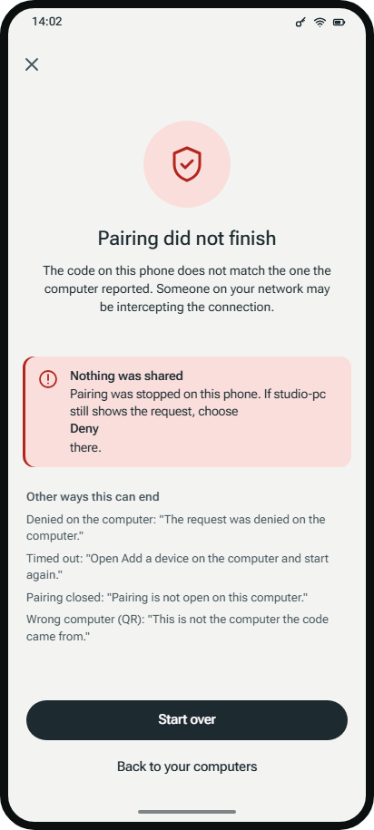</a> | **10. Add computer: failure** `add-fail`  The code mismatch case, worded as a possible interception, with the other failure texts listed.  [Light](png/android-phone/add-fail-light.png) · [Dark](png/android-phone/add-fail-dark.png) |
| <a href="png/android-phone/shares-light.png">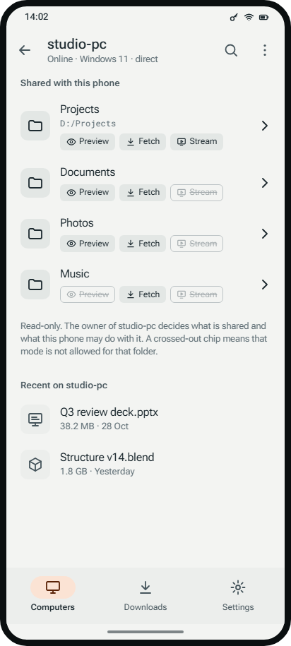</a> | **11. Shares** `shares`  The folders this phone may use on one computer, with what each allows.  [Light](png/android-phone/shares-light.png) · [Dark](png/android-phone/shares-dark.png) |
| <a href="png/android-phone/browser-light.png">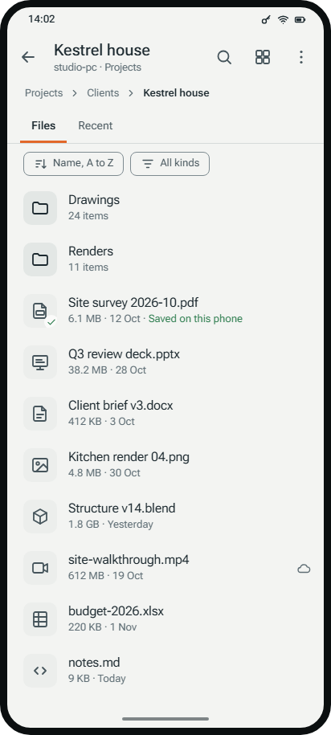</a> | **12. Browser: list** `browser`  A folder: breadcrumb, Files/Recent tabs, sort and filter chips, rows with type tiles and flags.  [Light](png/android-phone/browser-light.png) · [Dark](png/android-phone/browser-dark.png) |
| <a href="png/android-phone/browser-grid-light.png">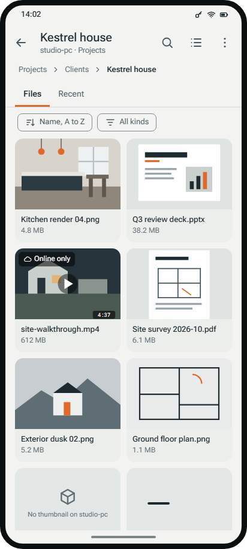</a> | **13. Browser: grid** `browser-grid`  Thumbnail grid. Thumbnails are made on the computer; the type glyph stands in when it has none.  [Light](png/android-phone/browser-grid-light.png) · [Dark](png/android-phone/browser-grid-dark.png) |
| <a href="png/android-phone/browser-sort-light.png">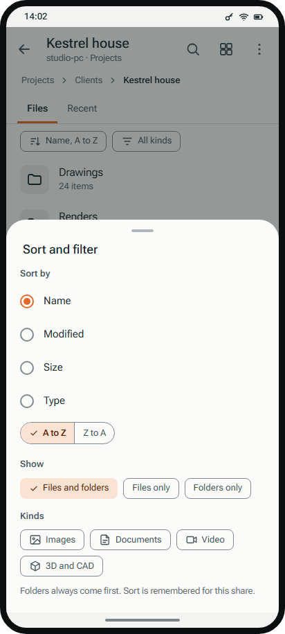</a> | **14. Browser: sort and filter** `browser-sort`  Bottom sheet for sort, direction, show and kinds. Remembered per share.  [Light](png/android-phone/browser-sort-light.png) · [Dark](png/android-phone/browser-sort-dark.png) |
| <a href="png/android-phone/browser-select-light.png">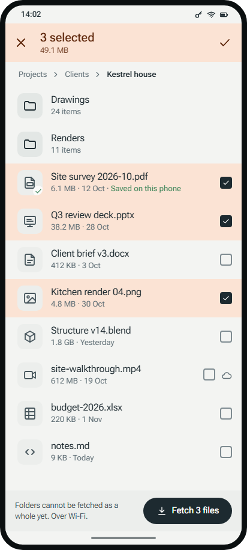</a> | **15. Browser: multi-select** `browser-select`  Long-press enters selection; the bar shows count and total size, and Fetch many. Folders are not selectable in v1.  [Light](png/android-phone/browser-select-light.png) · [Dark](png/android-phone/browser-select-dark.png) |
| <a href="png/android-phone/browser-offline-light.png">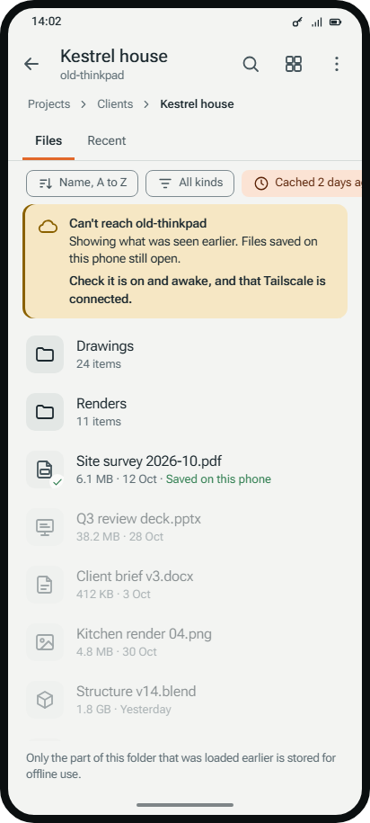</a> | **16. Browser: offline / cached** `browser-offline`  Host unreachable: the cached listing is shown with its age; only saved files are fully available.  [Light](png/android-phone/browser-offline-light.png) · [Dark](png/android-phone/browser-offline-dark.png) |
| <a href="png/android-phone/sheet-light.png">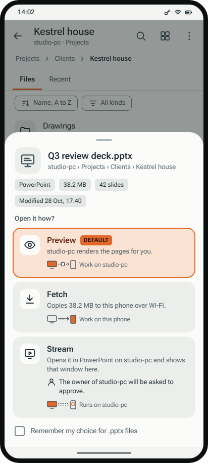</a> | **17. File sheet** `sheet`  The decision point: three modes, each with a cost hint and a work rail showing which device does the work. The default is outlined in orange.  [Light](png/android-phone/sheet-light.png) · [Dark](png/android-phone/sheet-dark.png) |
| <a href="png/android-phone/sheet-na-light.png">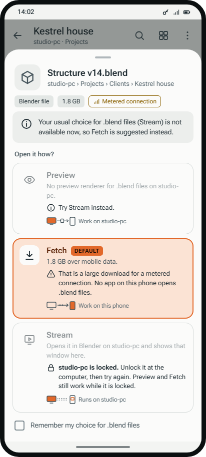</a> | **18. File sheet: unavailable modes** `sheet-na`  Honesty rules: every unavailable mode says why, in the sheet. The remembered default is overridden and that is said too.  [Light](png/android-phone/sheet-na-light.png) · [Dark](png/android-phone/sheet-na-dark.png) |
| <a href="png/android-phone/p-pages-light.png">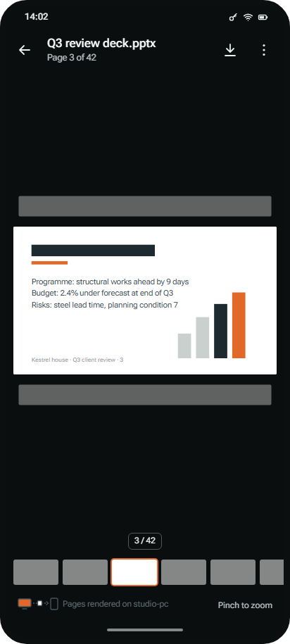</a> | **19. Preview: pages** `p-pages`  Paged document preview rendered on the computer, with a filmstrip and a Fetch shortcut.  [Light](png/android-phone/p-pages-light.png) · [Dark](png/android-phone/p-pages-dark.png) |
| <a href="png/android-phone/p-image-light.png">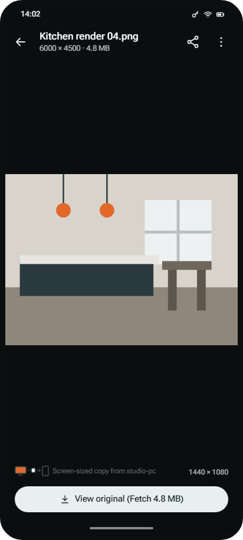</a> | **20. Preview: image** `p-image`  Screen-sized copy; the original is one tap away and costs a Fetch, said in the button.  [Light](png/android-phone/p-image-light.png) · [Dark](png/android-phone/p-image-dark.png) |
| <a href="png/android-phone/p-text-light.png">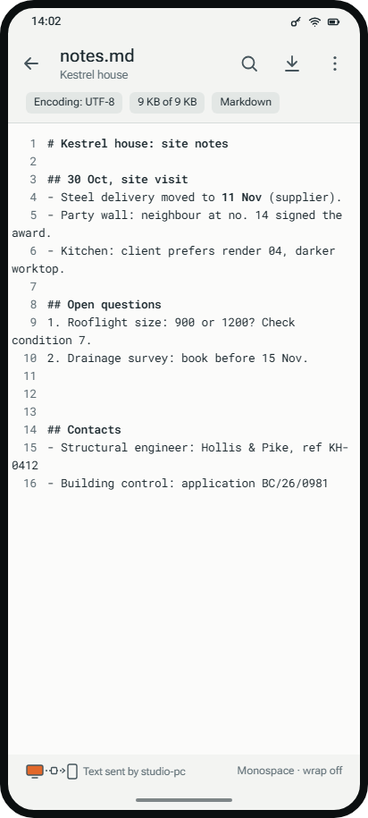</a> | **21. Preview: text** `p-text`  Monospace text with encoding shown and light highlighting.  [Light](png/android-phone/p-text-light.png) · [Dark](png/android-phone/p-text-dark.png) |
| <a href="png/android-phone/p-video-light.png">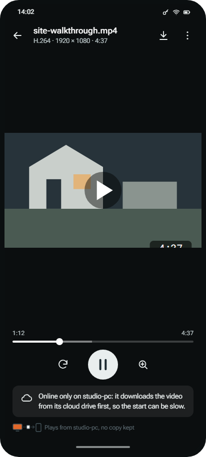</a> | **22. Preview: video** `p-video`  Plays straight from the computer by range requests; no copy kept.  [Light](png/android-phone/p-video-light.png) · [Dark](png/android-phone/p-video-dark.png) |
| <a href="png/android-phone/fetch-light.png">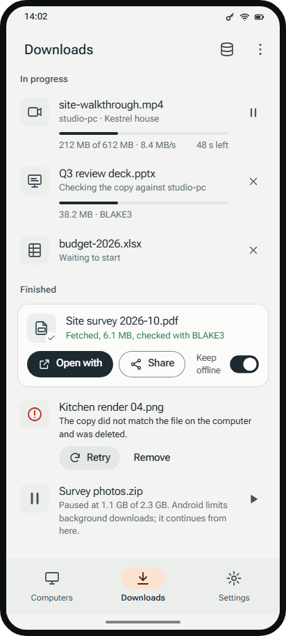</a> | **23. Downloads (fetch panel)** `fetch`  Every fetch in one place: progress, verifying, done with Open with / Share / Keep offline, failed with the reason.  [Light](png/android-phone/fetch-light.png) · [Dark](png/android-phone/fetch-dark.png) |
| <a href="png/android-phone/fetch-cellular-light.png">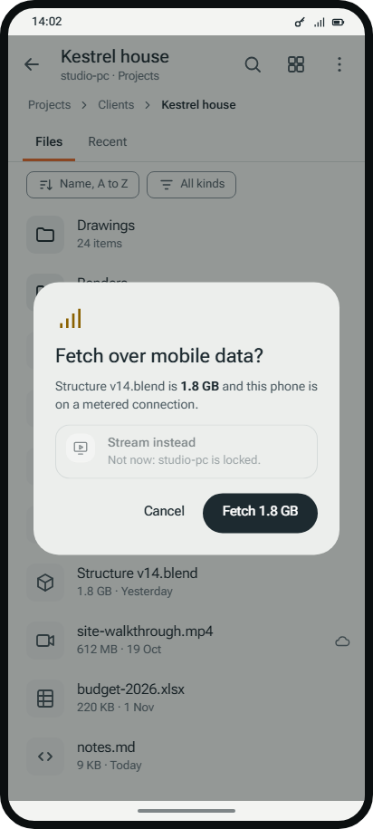</a> | **24. Fetch: mobile data dialog** `fetch-cellular`  Before a large fetch on a metered network: size first, cheaper alternatives offered (or why they are not available).  [Light](png/android-phone/fetch-cellular-light.png) · [Dark](png/android-phone/fetch-cellular-dark.png) |
| <a href="png/android-phone/storage-light.png">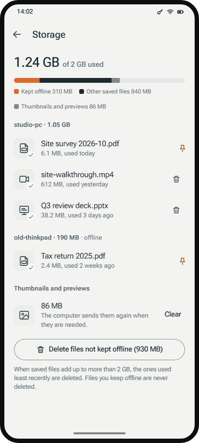</a> | **25. Storage** `storage`  What is saved on this phone, per computer, and what may be deleted.  [Light](png/android-phone/storage-light.png) · [Dark](png/android-phone/storage-dark.png) |
| <a href="png/android-phone/settings-light.png">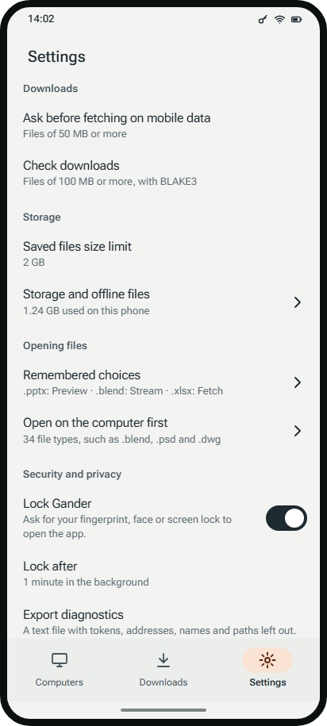</a> | **26. Settings** `settings`  Downloads, storage, opening rules, security, computers, about.  [Light](png/android-phone/settings-light.png) · [Dark](png/android-phone/settings-dark.png) |
| <a href="png/android-phone/lock-light.png">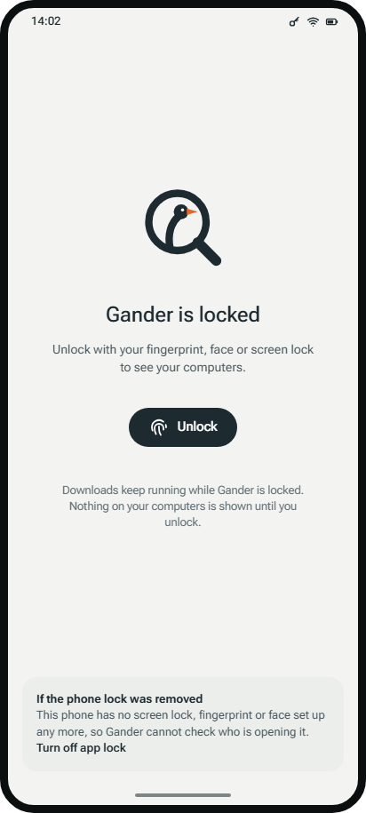</a> | **27. App lock** `lock`  Biometric gate after a minute in the background. Shows nothing about the computers until unlocked.  [Light](png/android-phone/lock-light.png) · [Dark](png/android-phone/lock-dark.png) |
| <a href="png/android-phone/stream-relay-light.png">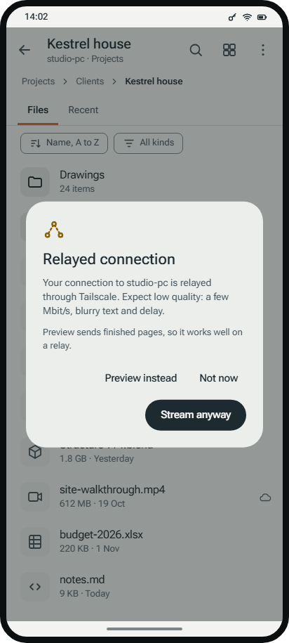</a> | **28. Stream: relay warning** `stream-relay`  Before a stream on a relayed path: quality expectation in plain words, with Preview as the honest alternative.  [Light](png/android-phone/stream-relay-light.png) · [Dark](png/android-phone/stream-relay-dark.png) |
| <a href="png/android-phone/stream-picker-light.png">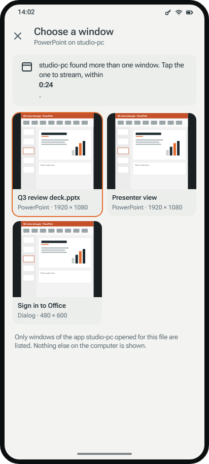</a> | **29. Stream: window picker** `stream-picker`  When the app opens more than one window, the user picks within a countdown.  [Light](png/android-phone/stream-picker-light.png) · [Dark](png/android-phone/stream-picker-dark.png) |
| <a href="png/android-phone/stream-live-light.png">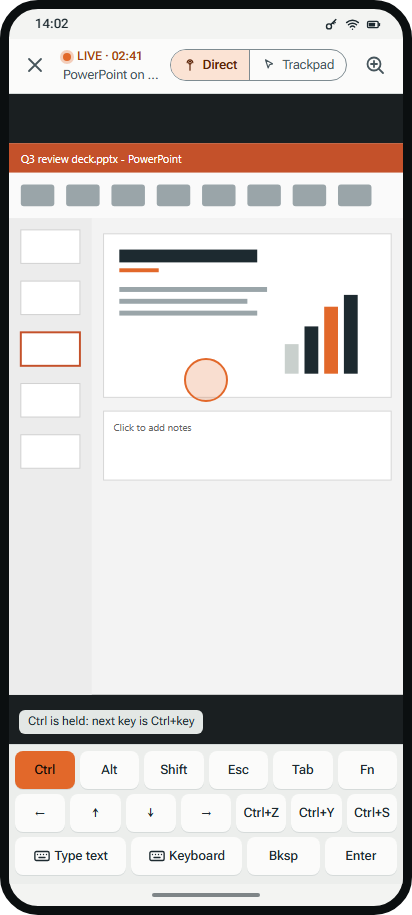</a> | **30. Stream: live, Direct touch** `stream-live`  The streamed window with a compact session bar (LIVE + time + where), mode switch, and the keyboard bar with sticky modifiers.  [Light](png/android-phone/stream-live-light.png) · [Dark](png/android-phone/stream-live-dark.png) |
| <a href="png/android-phone/stream-trackpad-light.png">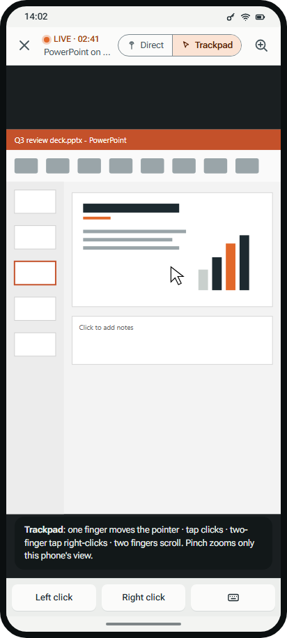</a> | **31. Stream: Trackpad mode** `stream-trackpad`  Pointer mode with a one-time gesture card, and click buttons in place of the keyboard bar.  [Light](png/android-phone/stream-trackpad-light.png) · [Dark](png/android-phone/stream-trackpad-dark.png) |
| <a href="png/android-phone/stream-paused-light.png">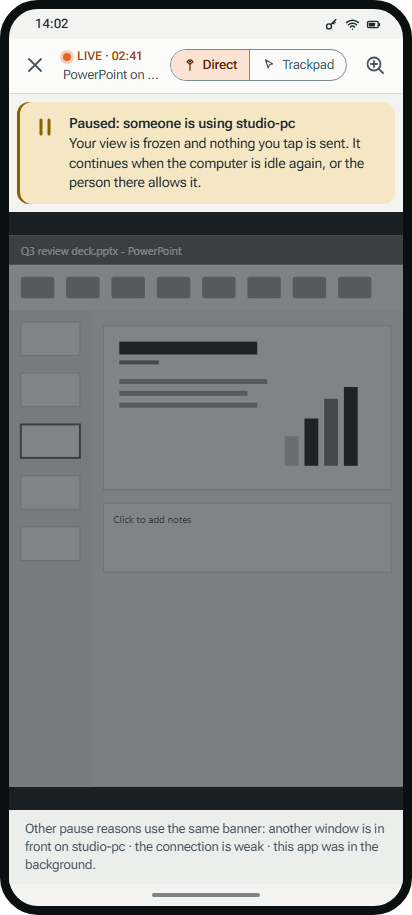</a> | **32. Stream: paused** `stream-paused`  The host paused input; the frame is greyed so it is never mistaken for live.  [Light](png/android-phone/stream-paused-light.png) · [Dark](png/android-phone/stream-paused-dark.png) |
| <a href="png/android-phone/stream-reconnecting-light.png">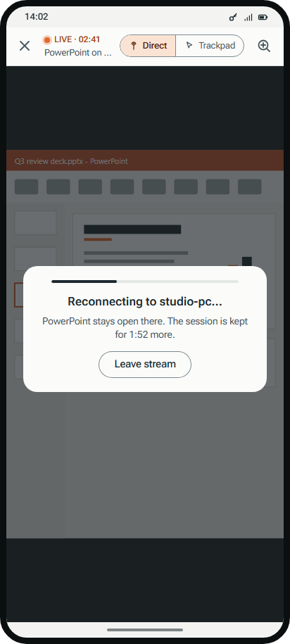</a> | **33. Stream: reconnecting** `stream-reconnecting`  Connection lost; the session is kept for 120 s and the countdown is shown.  [Light](png/android-phone/stream-reconnecting-light.png) · [Dark](png/android-phone/stream-reconnecting-dark.png) |
| <a href="png/android-phone/stream-end-light.png">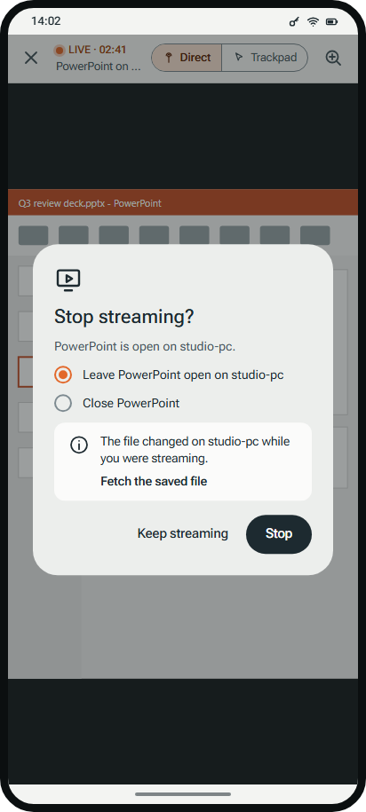</a> | **34. Stream: end dialog** `stream-end`  Leaving: keep or close the app on the computer, and fetch the saved file if it changed.  [Light](png/android-phone/stream-end-light.png) · [Dark](png/android-phone/stream-end-dark.png) |

## Android tablet

| Light | Screen |
| --- | --- |
| <a href="png/android-tablet/t-browser-light.png">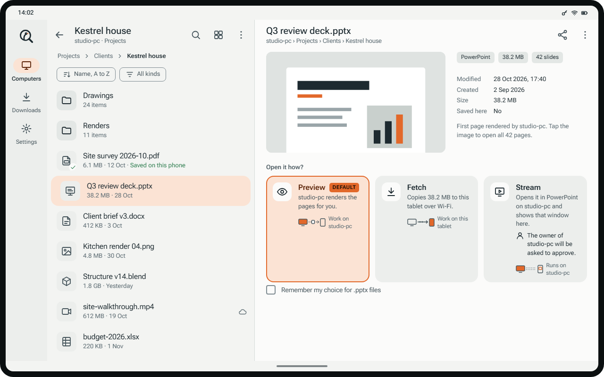</a> | **35. Tablet: two-pane browser** `t-browser`  Galaxy Tab S9 landscape: navigation rail, folder pane, and the file sheet as a persistent detail pane.  [Light](png/android-tablet/t-browser-light.png) · [Dark](png/android-tablet/t-browser-dark.png) |
| <a href="png/android-tablet/t-stream-light.png">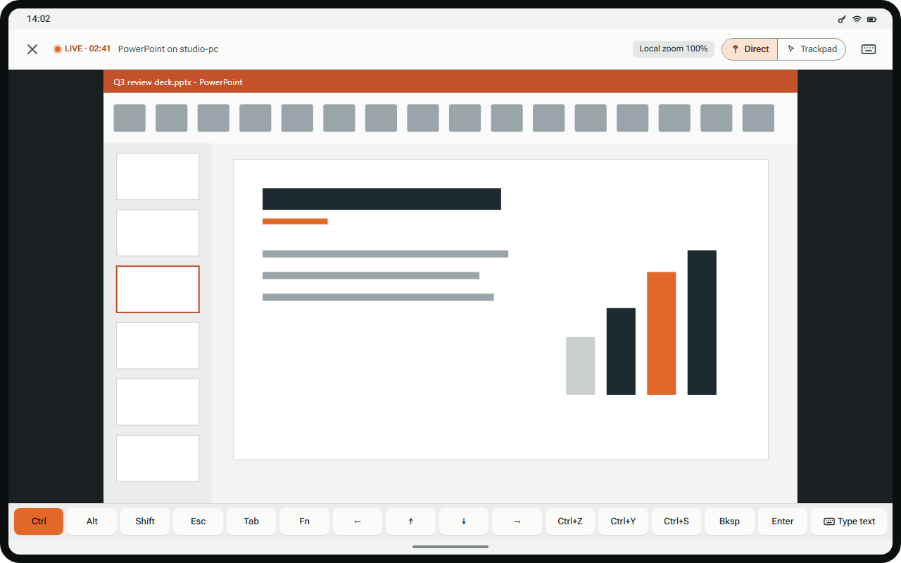</a> | **36. Tablet: stream** `t-stream`  Landscape stream with a single-row keyboard bar and the session bar on top.  [Light](png/android-tablet/t-stream-light.png) · [Dark](png/android-tablet/t-stream-dark.png) |

## Windows host

| Light | Screen |
| --- | --- |
| <a href="png/windows-host/h-tray-light.png">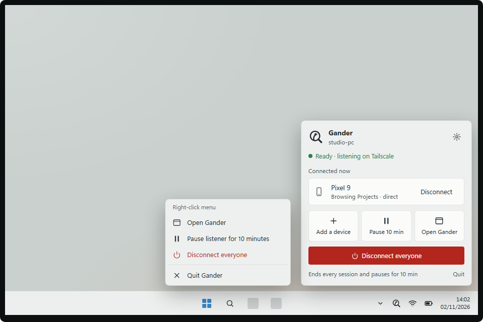</a> | **37. Tray flyout and menu** `h-tray`  Left-click flyout (status, who is connected, quick actions, kill switch) and the minimal right-click menu.  [Light](png/windows-host/h-tray-light.png) · [Dark](png/windows-host/h-tray-dark.png) |
| <a href="png/windows-host/h-shares-light.png">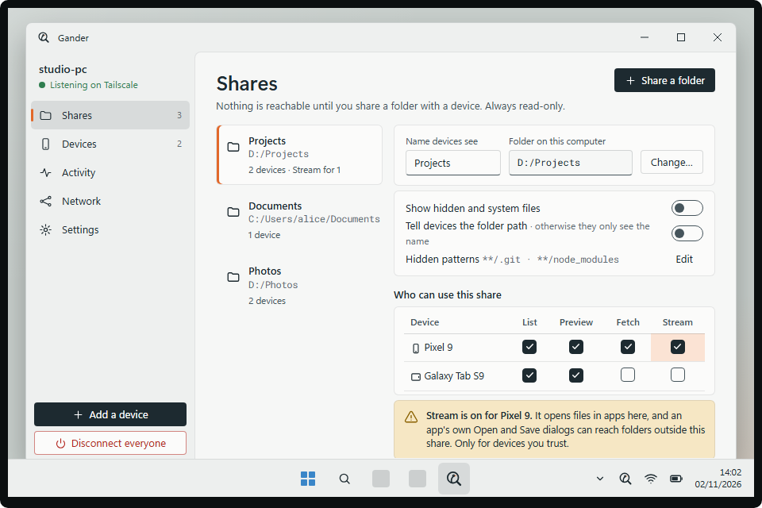</a> | **38. Shares** `h-shares`  Master-detail: shares on the left, the selected share with options and the per-device permission grid.  [Light](png/windows-host/h-shares-light.png) · [Dark](png/windows-host/h-shares-dark.png) |
| <a href="png/windows-host/h-shares-add-light.png">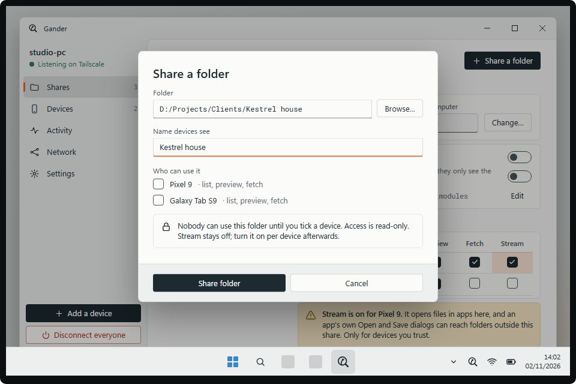</a> | **39. Shares: add a folder** `h-shares-add`  Content dialog for a new share. Every device starts unticked; Stream is never set here.  [Light](png/windows-host/h-shares-add-light.png) · [Dark](png/windows-host/h-shares-add-dark.png) |
| <a href="png/windows-host/h-devices-light.png">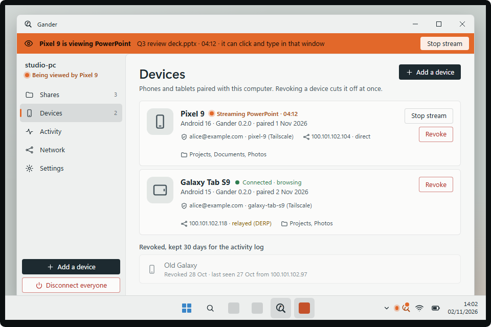</a> | **40. Devices (while being viewed)** `h-devices`  Paired devices with identity, path and what they are doing now. The live band runs across the window while a stream is on.  [Light](png/windows-host/h-devices-light.png) · [Dark](png/windows-host/h-devices-dark.png) |
| <a href="png/windows-host/h-add-light.png">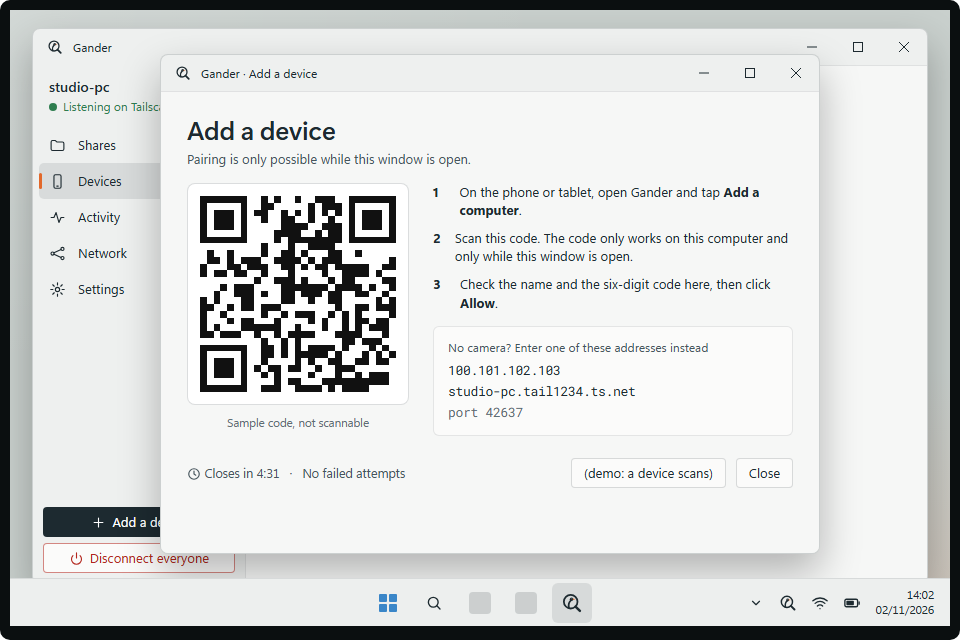</a> | **41. Add a device: QR** `h-add`  Pairing window: QR, three steps, manual addresses, expiry and failed-attempt count.  [Light](png/windows-host/h-add-light.png) · [Dark](png/windows-host/h-add-dark.png) |
| <a href="png/windows-host/h-add-approve-light.png">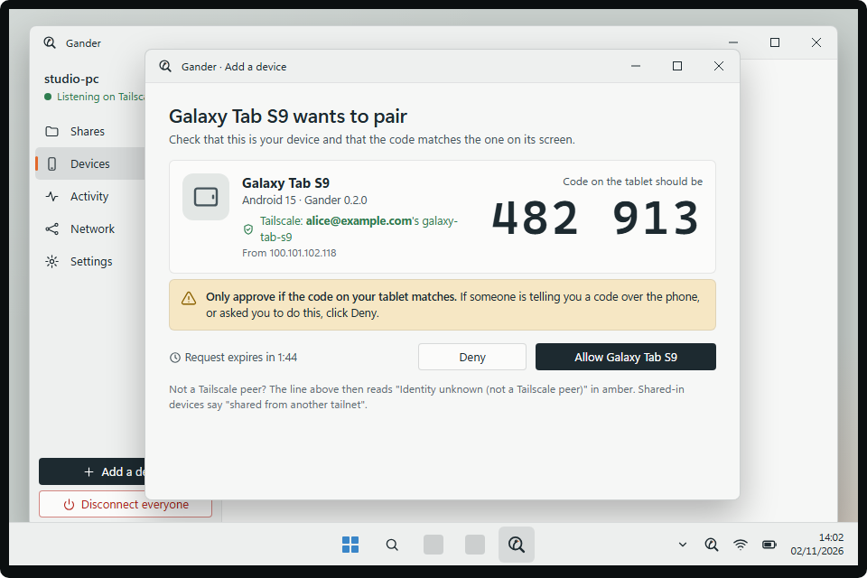</a> | **42. Add a device: approve** `h-add-approve`  The device asks to pair: identity, network login, large code, and Deny as wide as Allow.  [Light](png/windows-host/h-add-approve-light.png) · [Dark](png/windows-host/h-add-approve-dark.png) |
| <a href="png/windows-host/h-activity-light.png">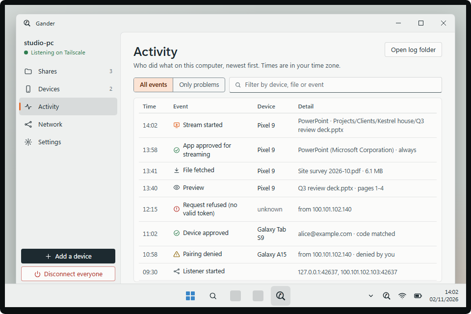</a> | **43. Activity** `h-activity`  The audit log in plain words, newest first, filterable.  [Light](png/windows-host/h-activity-light.png) · [Dark](png/windows-host/h-activity-dark.png) |
| <a href="png/windows-host/h-network-light.png">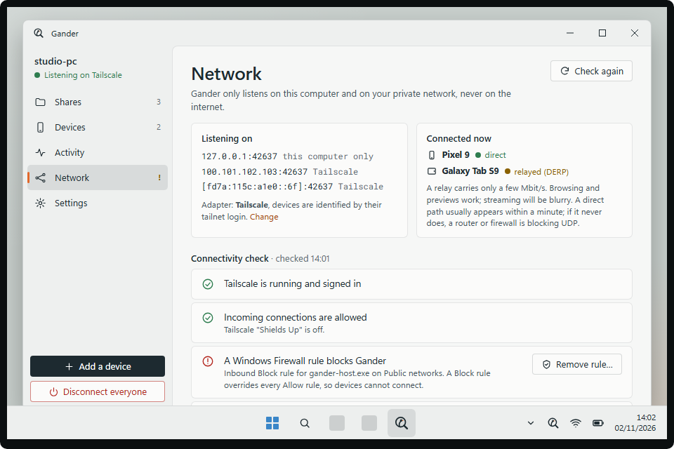</a> | **44. Network** `h-network`  Where Gander listens, how each device is connected, and a connectivity check with fixes.  [Light](png/windows-host/h-network-light.png) · [Dark](png/windows-host/h-network-dark.png) |
| <a href="png/windows-host/h-settings-light.png">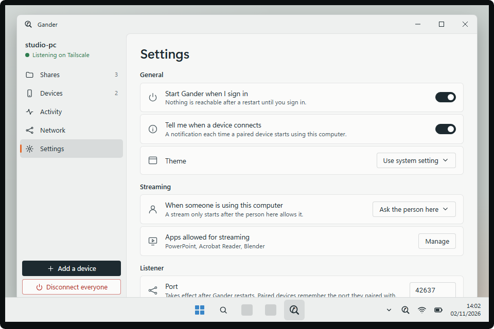</a> | **45. Settings** `h-settings`  Fluent settings cards: general, streaming, listener, storage.  [Light](png/windows-host/h-settings-light.png) · [Dark](png/windows-host/h-settings-dark.png) |
| <a href="png/windows-host/h-viewing-light.png">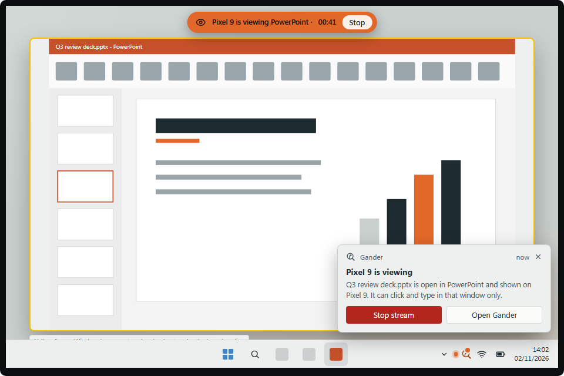</a> | **46. Being viewed: toast and indicator** `h-viewing`  Unmistakable: an orange pill at the top of the screen with Stop, a toast naming the device and the file, an orange dot on the tray icon, and the yellow Windows capture border around the streamed window (kept on, per the stream launch policy).  [Light](png/windows-host/h-viewing-light.png) · [Dark](png/windows-host/h-viewing-dark.png) |
| <a href="png/windows-host/h-prompt-light.png">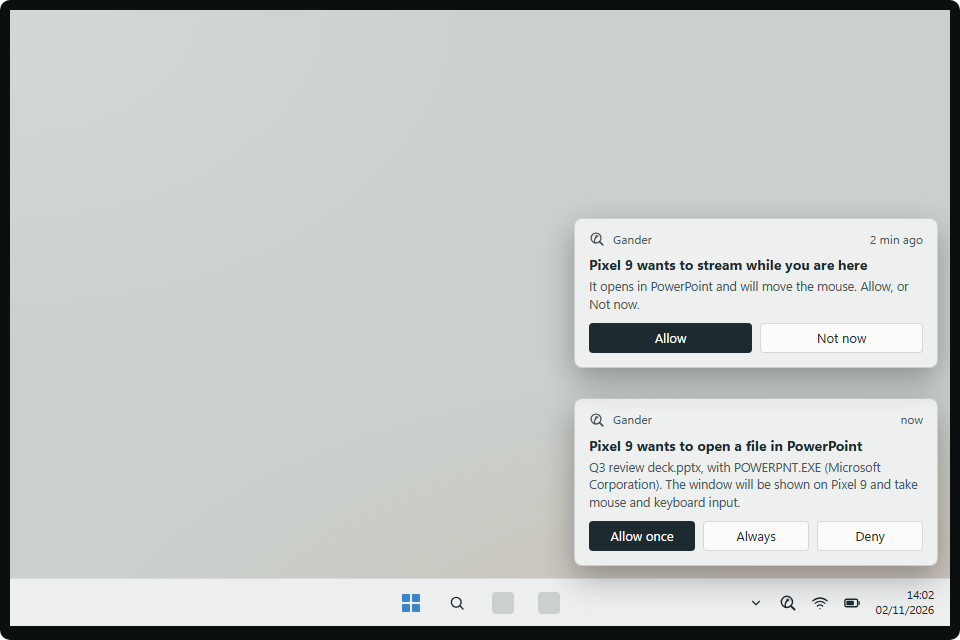</a> | **47. Stream approval prompts** `h-prompt`  Owner prompts: an app not yet approved, and someone at the keyboard.  [Light](png/windows-host/h-prompt-light.png) · [Dark](png/windows-host/h-prompt-dark.png) |
| <a href="png/windows-host/h-kill-light.png">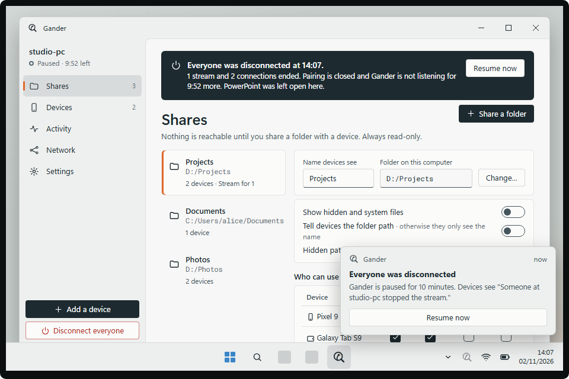</a> | **48. Kill switch used** `h-kill`  One click, no confirmation. The result is stated, and undo is "Resume now".  [Light](png/windows-host/h-kill-light.png) · [Dark](png/windows-host/h-kill-dark.png) |

